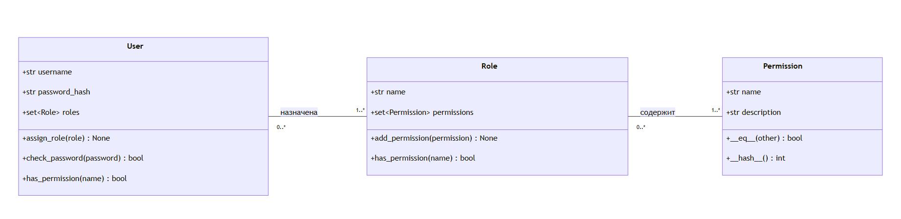
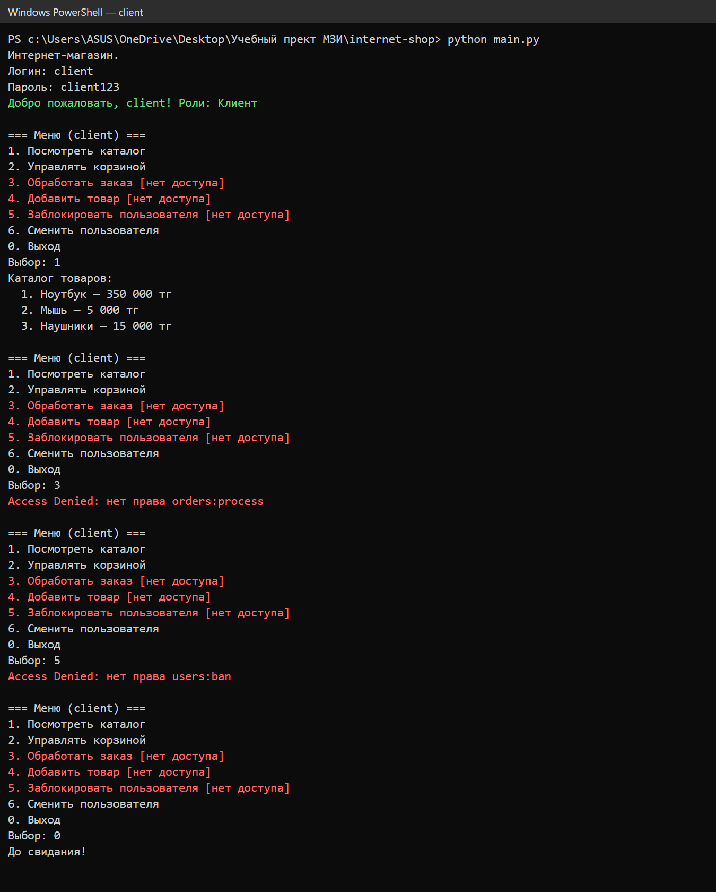
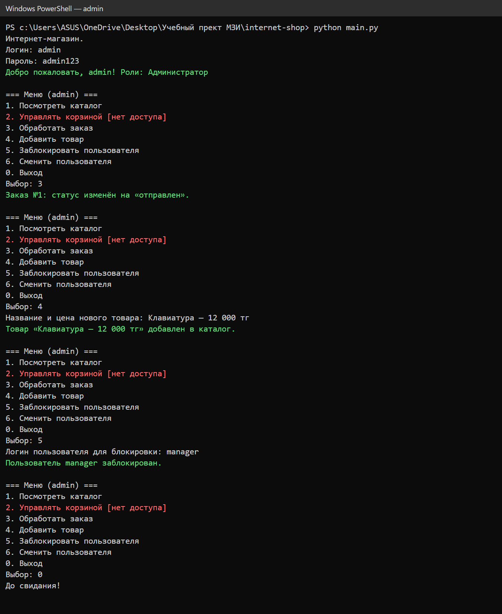

# Титульный лист

<div align="center">

**______________________________________________**
(полное название колледжа)

Специальность: Разработка программного обеспечения

<br><br>

**ОТЧЁТ**
по лабораторной работе № 7

**«Программирование ролевой модели доступа (RBAC)»**

по предмету «Методы защиты информации»

Вариант: «Интернет-магазин / Маркетплейс»

</div>

<br><br>

Выполнили студентки группы ____________:
1. ______________________________ (ФИО)
2. ______________________________ (ФИО)

Проверил(а) преподаватель: ______________________________

Дата сдачи: «___» ____________ 20___ г.  Оценка: ________

<div align="center">

г. ____________, 20___ г.

</div>

---

# Диаграмма классов



**Рисунок 1.** UML-диаграмма классов.

Исходник диаграммы (Mermaid) — файл `diagram.mmd`.

**Описание.** Модель состоит из трёх классов:

- **User (Пользователь)** — субъект системы. Поля: `username` (логин), `password_hash` (пароль, хранящийся в виде хеша SHA-256, а не открытым текстом), `roles` (множество ролей). Методы: `assign_role(role)` назначает роль; `check_password(password)` хеширует введённый пароль и сравнивает с сохранённым хешем; `has_permission(name)` проверяет, есть ли право хотя бы у одной роли пользователя.
- **Role (Роль)** — должность или функция в магазине: Клиент, Менеджер по продажам, Контент-менеджер, Администратор. Поля: `name`, `permissions` (множество прав). Методы: `add_permission(permission)` добавляет право в роль; `has_permission(name)` проверяет, есть ли право у роли.
- **Permission (Право)** — разрешённое действие над ресурсом в формате `ресурс:действие`, например `catalog:read`. Поля: `name`, `description`. Методы `__eq__` и `__hash__` сравнивают права по имени, чтобы во множестве (`set`) не было дубликатов.

**Связи:**

- User ↔ Role — «многие ко многим»: у пользователя может быть несколько ролей (например, `blogger` — Клиент и Контент-менеджер), а одна роль назначается многим пользователям.
- Role ↔ Permission — «многие ко многим»: роль содержит несколько прав, одно право (например, `catalog:read`) входит в несколько ролей.

Пользователь **никогда не связан с правами напрямую** — только через роли.

**Матрица доступа (из data.json):**

| Право | Клиент | Менеджер по продажам | Контент-менеджер | Администратор |
|---|:-:|:-:|:-:|:-:|
| catalog:read — просмотр каталога | + | + | + | + |
| cart:manage — корзина и заказ | + | | | |
| orders:process — обработка заказов | | + | | + |
| products:write — товары | | | + | + |
| users:ban — блокировка | | | | + |

Тестовые пользователи: `client` (Клиент), `manager` (Менеджер по продажам), `content` (Контент-менеджер), `admin` (Администратор), `blogger` (Клиент + Контент-менеджер). Пароли — логин + `123`.

---

# Скриншоты работы программы

**Рисунок 2.** Вход под `client` (роль Клиент). Пункты без права помечены «[нет доступа]», при попытке обработать заказ и заблокировать пользователя выводится «Access Denied».



**Рисунок 3.** Вход под `admin` (роль Администратор). Обработка заказа, добавление товара и блокировка пользователя выполняются успешно. Корзина администратору недоступна: права `cart:manage` у роли Администратор нет (принцип наименьших привилегий).



Полный текстовый вывод тестового запуска (client, admin, blogger) — файл `demo_output.txt`.

---

# Выводы

В ходе работы мы изучили модель ролевого разграничения доступа RBAC и реализовали её на Python для сценария «Интернет-магазин». Программа загружает права, роли и пользователей из файла `data.json`, проверяет пароль по хешу SHA-256 и перед каждым действием вызывает `check_access(user, право)`. Пользователь без нужного права получает сообщение «Access Denied».

Преимущества RBAC по сравнению с жёстко зашитыми проверками в коде (`if user == "admin"` или `if role == "Администратор"`):

1. **Права меняются без изменения кода.** Чтобы дать Менеджеру право добавлять товары, достаточно дописать `products:write` к роли в `data.json`. При жёстких проверках пришлось бы искать и править все `if` в программе.
2. **Меньше ошибок и «дыр».** Проверка находится в одном месте (`check_access`), поэтому нельзя забыть добавить новую роль в один из десятка `if`.
3. **Удобное администрирование.** Новому сотруднику просто назначают роль, а не настраивают права по одному. Уволенному — роль снимают.
4. **Наглядность и аудит.** Матрицу «роль — право» легко прочитать и проверить, её можно показать службе безопасности.
5. **Поддержка нескольких ролей.** Один пользователь может совмещать обязанности (как `blogger`), права ролей складываются автоматически.
6. **Принцип наименьших привилегий.** Каждой роли даются только те права, которые нужны для работы; всё, что не разрешено явно, запрещено.

---

# Контрольные вопросы

## 3. Что такое иерархия ролей в RBAC и как её можно реализовать в коде?

**Иерархия ролей** (модель RBAC1) — это наследование: старшая роль автоматически получает все права младшей роли, плюс свои. Например: «Администратор» наследует «Менеджера по продажам» и «Контент-менеджера», а те наследуют «Клиента». Тогда не нужно повторять одно и то же право (например, `catalog:read`) в каждой роли.

**Как реализовать в коде.** В класс `Role` добавляется список родительских ролей, а при проверке права обходятся и они (рекурсивно):

```python
class Role:
    def __init__(self, name):
        self.name = name
        self.permissions = set()
        self.parents = set()          # роли, от которых наследуем права

    def all_permissions(self):
        # свои права + права всех родительских ролей
        result = set(self.permissions)
        for parent in self.parents:
            result |= parent.all_permissions()
        return result

class User:
    def has_permission(self, name):
        for role in self.roles:
            for perm in role.all_permissions():
                if perm.name == name:
                    return True
        return False
```

В `data.json` это записывается полем `"inherits": ["Клиент"]` у роли. Важно не допустить циклов (A наследует B, а B наследует A) — иначе будет бесконечная рекурсия. В нашей работе иерархия не используется (модель RBAC0), права каждой роли перечислены явно.

## 4. Как ваша программа поведёт себя, если у пользователя две роли, одна из которых разрешает действие, а вторая ничего не говорит? (Принцип наименьших привилегий)

**Действие будет разрешено.** В нашей модели права всех ролей пользователя **объединяются** (логическое «ИЛИ»): `has_permission` возвращает `True`, если право есть хотя бы у одной роли. «Молчание» второй роли не является запретом — в RBAC0 нет запрещающих правил, есть только разрешения.

Пример из программы: у `blogger` роли Клиент и Контент-менеджер. Право `products:write` есть только у Контент-менеджера, у Клиента его нет — но `blogger` может добавить товар (пункт «Добавить товар» доступен). А право `users:ban` нет ни у одной из его ролей — получаем «Access Denied: нет права users:ban».

**Связь с принципом наименьших привилегий:** по умолчанию всё запрещено (`check_access` возвращает `False`, если права не нашлось). Пользователь получает **только** то, что явно разрешено его ролями. Поэтому назначать вторую роль нужно осознанно: она добавляет все свои права. Если нужно запретить действие — роль не назначают или убирают право из роли (а не надеются, что другая роль «перекроет» его).
